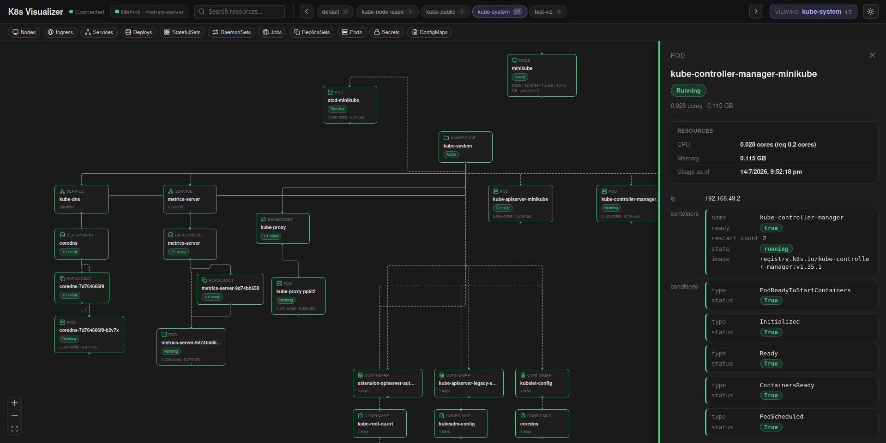
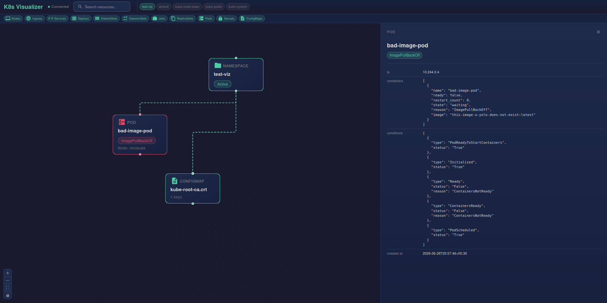
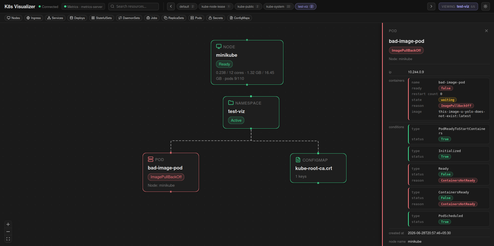

# Kubernetes Cluster Visualizer

Real-time topology graph for a Kubernetes cluster: resources, ownership/routing edges, health, and optional CPU/memory usage.







## Features

- Topology graph: Pods, Deployments, ReplicaSets, Services, Ingresses, StatefulSets, DaemonSets, Jobs, Secrets, ConfigMaps, Nodes
- Edges: ownership (Deploy/RS/STS/DS/Job -> Pod), Service selectors, Ingress -> Service
- One namespace at a time (full canvas) with switcher; related resources grouped as DAG columns
- Live updates via informers + WebSocket (not polling)
- Resource type filters, search, detail panel (status, containers, conditions, usage)
- Optional metrics via Metrics Server (`kubectl top` API): pod/node CPU (cores) and memory (GB)
- Pod logs in the detail panel: time windows (last 30s / 1m / 5m / 15m / 1h / all), "load earlier", live follow, previous-container logs, filter, download
- Time travel: a timeline at the top-left lets you scrub back (default 5m) and see the namespace as it was, with markers for pod errors, creations and deletions; logs follow the selected time
- Deleted pods are kept for a while (default 1m) as faded "ghost" nodes with their final status, container exit reasons, events and the logs captured while they were terminating

## Prerequisites

- Go 1.26+
- Node.js >= 20.10, npm >= 10.8 (dev UI only)
- Cluster access (`KUBECONFIG` or in-cluster SA)
- Optional: Metrics Server for usage (`minikube addons enable metrics-server`)

## Quick start (out of cluster)

```bash
export KUBECONFIG=~/.kube/config   # if needed
go mod tidy
go run main.go
```

- UI (embedded): http://localhost:8081
- WebSocket: :8080

Dev frontend (hot reload):

```bash
cd ui && npm install && npm run dev
# http://localhost:5173  (WS still :8080)
```

After UI changes that ship with the binary:

```bash
cd ui && npm run build
# commit ui/dist (//go:embed)
```

## Metrics

Default: `METRICS_PROVIDER=metrics-server`. Topology works without it.

| Env | Default | Notes |
|-----|---------|--------|
| `METRICS_PROVIDER` | `metrics-server` | or `none` |
| `METRICS_INTERVAL` | `15s` | scrape period |
| `METRICS_TIMEOUT` | `10s` | per scrape |

See [docs/metrics.md](./docs/metrics.md).

## History (time travel)

The backend records how every object changes and can rebuild the cluster state at any moment in the window.

| Env | Default | Notes |
|-----|---------|--------|
| `HISTORY_WINDOW` | `5m` | how far back you can scrub; `0` disables |
| `HISTORY_MAX_MB` | `64` | memory budget; when exceeded the oldest history is dropped first |

Built for large, busy clusters:
- Each object is stored as a list of versions with validity intervals, so memory grows with the rate of change, not with object count x time.
- Objects whose `resourceVersion` didn't change are skipped without encoding; changes that don't affect what the UI shows (e.g. heartbeats) are deduplicated by hash.
- CPU/memory usage and events aren't versioned (they'd dominate churn); snapshots show events by first-seen time.
- Snapshots are assembled from stored JSON without decoding, gzipped, and cached per second.

History lives in memory and starts when the backend starts.

## Deleted pod retention

When a pod starts terminating, the backend follows its container logs; when it is deleted, a snapshot (status, exit codes/reasons, captured logs) is kept in memory so you can see why it went away.

| Env | Default | Notes |
|-----|---------|--------|
| `POD_RETENTION` | `1m` | how long deleted pods stay visible; `0` disables |
| `POD_RETENTION_MAX` | `100` | max deleted pods kept (oldest dropped first) |

Logs can't be captured for pods removed without a terminating phase (e.g. `--force --grace-period=0`). Logs need `get` on `pods/log` (included in `yamls/all-in-one.yaml`).

## In-cluster

```bash
kubectl create -f https://raw.githubusercontent.com/Saumya40-codes/k8s-visualizer/refs/heads/master/yamls/all-in-one.yaml
kubectl get pods
kubectl port-forward svc/k8s-visualizer-backend-<tag> 8081:8081
kubectl port-forward svc/k8s-visualizer-backend-<tag> 8080:8080
```

Open http://localhost:8081

## Architecture

```
React UI (:8081 / Vite :5173)
    |  WebSocket
Go backend (:8080)
    |  SharedInformers (List+Watch) + optional metrics.k8s.io
Kubernetes API
```

State is rebuilt on informer events (debounced) and pushed to all WS clients. Metrics enrich pod/node usage when available.

## License

See repository license file if present.
